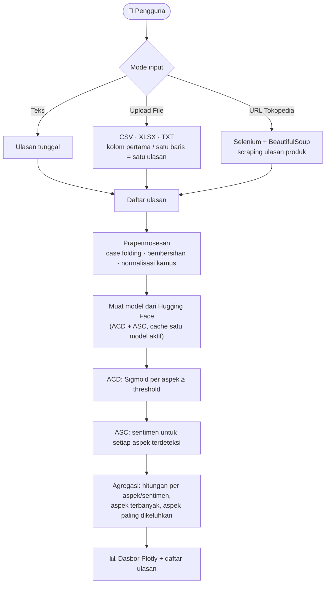
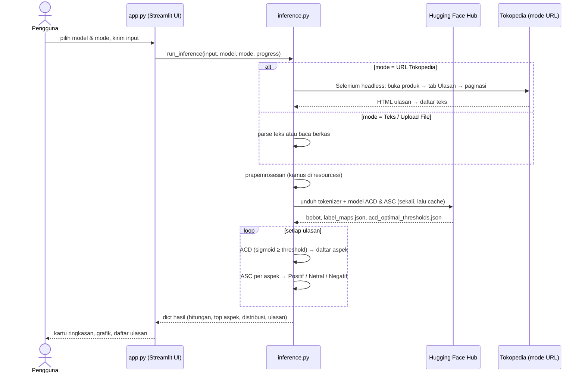

<div align="center">

# ABSA Streamlit App
### Pemetaan Keluhan pada Ulasan Produk Monitor dengan Aspect-Based Sentiment Analysis (IndoBERT & mBERT)

Prototipe web *proof of concept* dari skripsi **“Implementasi Aspect-Based Sentiment Analysis (ABSA) Berbasis IndoBERT untuk Pemetaan Keluhan pada Ulasan Produk Monitor”**


[Fitur](#-fitur) · [Cara Kerja End-to-End](#-cara-kerja-end-to-end) · [Instalasi](#️-instalasi-dan-menjalankan) · [Deploy](#-deploy-ke-streamlit-community-cloud) · [Catatan Teknis](#-catatan-teknis-dan-keterbatasan)

[<!-- Tambahkan tautan demo di sini bila aplikasi sudah dideploy -->
](https://absa-app-finish-louders.streamlit.app/)
</div>

---

## 📌 Tentang Proyek

Aplikasi ini menerima ulasan produk (satu teks, berkas, atau tautan produk Tokopedia), lalu menjawab tiga pertanyaan:

1. **Aspek apa** yang dibahas pada ulasan? (*Aspect Category Detection*, ACD)
2. **Bagaimana sentimen** untuk setiap aspek tersebut? (*Aspect Sentiment Classification*, ASC)
3. **Aspek mana yang paling banyak dibahas dan paling banyak dikeluhkan** pada keseluruhan ulasan?

Model tidak disimpan di repositori ini. Seluruhnya diambil dari **Hugging Face Hub** saat aplikasi dijalankan. Kode pelatihan dan evaluasi ada di repositori penelitian: [**absa-louders-yoakim-telaumbanua**](https://github.com/loudersyoakim/absa-louders-yoakim-telaumbanua).

### 🤗 Model yang dipakai

| Pilihan di aplikasi | Tugas | Repositori Hugging Face |
|---|---|---|
| **IndoBERT** | ACD (deteksi aspek, multi-label) | [`loudersyoakim/absa-indobert-acd`](https://huggingface.co/loudersyoakim/absa-indobert-acd) |
| **IndoBERT** | ASC (sentimen per aspek) | [`loudersyoakim/absa-indobert-asc`](https://huggingface.co/loudersyoakim/absa-indobert-asc) |
| **mBERT** | ACD (deteksi aspek, multi-label) | [`loudersyoakim/absa-mbert-acd`](https://huggingface.co/loudersyoakim/absa-mbert-acd) |
| **mBERT** | ASC (sentimen per aspek) | [`loudersyoakim/absa-mbert-asc`](https://huggingface.co/loudersyoakim/absa-mbert-asc) |

### Kinerja model (data uji penelitian)

| | IndoBERT | mBERT |
|---|:---:|:---:|
| ACD · F1-Micro / F1-Macro | **0,8900** / **0,8523** | 0,8753 / 0,8417 |
| ASC · F1-Macro (aspek *ground-truth*) | **0,9074** | 0,8956 |
| ASC · F1-Macro *end-to-end* (aspek dari ACD) | **0,7915** | 0,7645 |
| Threshold ACD optimal | 0,45 | 0,30 |

Rincian metodologi, uji statistik, dan keterbatasan ada di [repositori penelitian](https://github.com/loudersyoakim/absa-louders-yoakim-telaumbanua).

---

## ✨ Fitur

- **Tiga mode input:** teks tunggal, unggah berkas (CSV / XLSX / TXT, boleh banyak berkas), dan **URL produk Tokopedia** (ulasan diambil otomatis).
- **Prapemrosesan identik dengan pelatihan:** case folding, pembersihan simbol, serta normalisasi jargon teknis (mis. `144 hz` → `144Hz`) dan kata baku/typo lewat tiga kamus di `resources/`.
- **Pilihan model:** IndoBERT atau mBERT dari sidebar; hanya satu model dimuat ke memori pada satu waktu.
- **Sembilan kategori aspek:** kinerja visual, keandalan & cacat, desain & fitur, komunikasi penjual, layanan purna jual, akurasi informasi, pengemasan & pengiriman, harga & nilai, umum.
- **Dasbor interaktif (Plotly):** kartu aspek paling dibahas dan paling dikeluhkan, diagram pai distribusi aspek dan sentimen, *stacked bar* sentimen per aspek, serta daftar ulasan per aspek dan sentimen.
- **Threshold otomatis** per model dari hasil kalibrasi penelitian (IndoBERT 0,45 · mBERT 0,30).
- **Tema gelap** dengan antarmuka bergaya percakapan (kolom input di bagian bawah).

---

## 🔄 Cara Kerja End-to-End

### Gambaran besar



### Urutan kejadian pada satu analisis



### Langkah demi langkah

#### 1. Antarmuka dan input (`app.py`)

- `st.set_page_config(layout="wide")` dengan CSS kustom bertema gelap.
- **Sidebar:** tombol *Percakapan Baru* (mengosongkan hasil), pilihan **Model** (`IndoBERT` / `mBERT`), dan pilihan **Metode Input** (`Teks` / `Upload File` / `URL Tokopedia`).
- **Kolom input** berubah mengikuti mode:
  - `Teks` → `st.chat_input` untuk satu ulasan.
  - `URL Tokopedia` → `st.chat_input` untuk menempel tautan produk.
  - `Upload File` → formulir dengan `st.file_uploader` (`csv`, `txt`, `xlsx`, multi-berkas) dan tombol kirim.
- Status proses ditampilkan lewat `st.status`, dengan pesan kemajuan dari tiap tahap inferensi. Hasil disimpan di `st.session_state.analysis_results`, lalu halaman di-*rerun* untuk menampilkan dasbor.

#### 2. Pengambilan ulasan (`inference.py → run_inference`)

| Mode | Perlakuan |
|---|---|
| **Teks** | Satu ulasan. Judul hasil diambil dari 5 kata pertama. |
| **Upload File** | `.csv` / `.xlsx`: **kolom pertama** dibaca sebagai ulasan; `.txt`: **satu baris = satu ulasan**. Beberapa berkas digabung; berkas yang gagal dibaca dilewati. |
| **URL Tokopedia** | Validasi URL (`tokopedia.com`, minimal dua segmen path) → *scraping* (lihat bagian berikutnya). Judul hasil = nama produk. |

Bila tidak ada ulasan yang didapat, aplikasi menampilkan: *“Mohon maaf, ulasan tidak berhasil didapatkan.”*

#### 3. Scraping Tokopedia (`scrape_tokopedia_reviews`)

1. Membuka Chromium *headless* (Selenium) pada halaman produk (hingga 3 kali percobaan).
2. Mengambil nama produk dan menutup *pop-up* bila ada.
3. Menggulir halaman dan **mengklik tab “Ulasan”**.
4. Pada setiap halaman ulasan: mengklik **“Selengkapnya”** agar teks panjang terbuka, mengurai HTML dengan BeautifulSoup (`section#review-feed` → elemen `lblItemUlasan`, minimal 5 karakter), membuang duplikat.
5. Klik **“Laman berikutnya”**; berhenti bila tombol habis, setelah **2 halaman beruntun tanpa ulasan baru**, atau mencapai **maksimum 20 halaman**.

#### 4. Prapemrosesan (`preprocess_text`)

Setiap ulasan diprapemroses **sama persis dengan saat pelatihan** (`01_preprocessing.ipynb` pada repositori penelitian), karena model dilatih pada teks yang sudah dinormalisasi:

| Urutan | Langkah | Contoh |
|:---:|---|---|
| 1 | **Case folding**: seluruh teks menjadi huruf kecil | `Hallo Kaka` → `hallo kaka` |
| 2 | **Pembersihan**: karakter non-alfanumerik (tanda baca, emoji, simbol) diganti spasi, spasi berlebih dirapikan | `lama!!!` → `lama` |
| 3 | **Normalisasi jargon teknis** (regex berbatas kata) dari `resources/kamus_teknis.csv` | `144 hz` → `144Hz` |
| 4 | **Normalisasi kata baku dan typo** per kata dari `resources/kamuskatabaku.xlsx` dan `resources/kamus_kata_baku2.csv` | `hallo` → `halo`, `ga` → `tidak` |

Catatan perilaku:

- Ulasan yang **kosong setelah dibersihkan** (mis. hanya emoji atau `@`) dilewati, seperti pada tahap pelatihan.
- Teks yang ditampilkan di dasbor tetap **teks asli pengguna**; hanya model yang menerima teks hasil normalisasi.
- Bila salah satu berkas kamus tidak ditemukan, aplikasi tetap berjalan (case folding dan pembersihan tetap dilakukan) dan menulis peringatan di log. Pastikan folder `resources/` ikut ter-*deploy*.

#### 5. Pemuatan model dari Hugging Face (`get_models`)

- Tokenizer dan model **ACD + ASC** untuk pilihan model diunduh dari Hub dan dipindah ke GPU bila tersedia, jika tidak ke CPU.
- **Hanya satu model aktif** di memori: saat pengguna berpindah IndoBERT ↔ mBERT, model lama dilepas (`gc.collect()` dan `torch.cuda.empty_cache()`) sebelum memuat yang baru. Akses dilindungi *lock* agar aman untuk beberapa sesi.
- `label_maps.json` dibaca dari repo IndoBERT-ASC (cadangan: daftar label bawaan), dan **threshold** dari `acd_optimal_thresholds.json` pada repo ACD (cadangan: IndoBERT 0,45 · mBERT 0,30).
- Token Hugging Face bersifat **opsional** (`HF_TOKEN` pada *secrets*), hanya perlu bila repo bersifat privat atau terkena batas laju.

#### 6. Inferensi per ulasan (`_analyze_single`)

1. **ACD:** tokenisasi (maks. 128 token) → model → `sigmoid(logits)` menghasilkan 9 probabilitas independen → aspek dengan probabilitas **≥ threshold** dianggap terdeteksi.
2. **ASC:** untuk **setiap aspek terdeteksi**, ulasan dan kode aspek dikirim sebagai **pasangan kalimat** (`[CLS] ulasan [SEP] kode_aspek [SEP]`, sama dengan format pelatihan); kelas dipilih dengan `argmax` atas `{Negatif, Netral, Positif}`.
3. Hasil ulasan = pemetaan `aspek → sentimen`.

#### 7. Agregasi hasil

Untuk seluruh ulasan, aplikasi menghitung:

| Keluaran | Definisi |
|---|---|
| Hitungan per aspek | Jumlah Positif / Netral / Negatif tiap aspek |
| **Aspek paling dibahas** | Aspek dengan total kemunculan terbanyak; persentase = porsi dari seluruh kemunculan aspek |
| **Aspek paling dikeluhkan** | Aspek dengan **jumlah ulasan negatif terbanyak** (seri → rasio negatif tertinggi); persentase = rasio negatif aspek tersebut |
| Distribusi aspek | Total kemunculan tiap aspek (diagram pai) |
| Distribusi sentimen total | Jumlah Positif / Netral / Negatif seluruh pasangan aspek–sentimen |
| Contoh ulasan | Hingga 30 ulasan per aspek per sentimen (teks asli, dipotong 220 karakter) |

#### 8. Tampilan hasil

1. Judul hasil: `ABSA – <model>` dan `<mode> – <judul ulasan>`.
2. Dua **kartu ringkasan** (aspek paling dibahas dan paling dikeluhkan) dengan *sentiment bar* hijau/abu/merah.
3. Dua **diagram pai**: distribusi aspek dan distribusi sentimen total.
4. ***Stacked bar*** sentimen per aspek.
5. **Detail ulasan per aspek:** tiap aspek berupa *expander* berisi daftar ulasan Positif / Netral / Negatif (3 pertama ditampilkan, tombol *Lihat selengkapnya* untuk sisanya) dan donat sentimen aspek tersebut.

#### 9. Penanganan galat

| Galat | Pesan ke pengguna |
|---|---|
| `InvalidTokopediaURLError` | URL yang diinput tidak valid. |
| `ReviewsNotFoundError` | Mohon maaf, ulasan tidak berhasil didapatkan. |
| `ScraperUnavailableError` | Layanan *scraping* tidak tersedia (pesan rinci ditampilkan) |
| `ModelLoadError` | Gagal memuat model dari Hugging Face |
| `ValueError` / lainnya | Pesan galat ditampilkan, status proses menjadi *error* |

---

## 🗂️ Struktur Repositori

```text
absa-streamlit-app/
├── app.py              # Antarmuka Streamlit: sidebar, input, dasbor hasil
├── inference.py        # Pipeline: input → scraping → ACD → ASC → agregasi; pemuatan model HF
├── utils.py            # Kode & nama aspek (A1–D1), deskripsi aspek, info model, pembuat laporan Markdown
├── requirements.txt    # Dependensi Python
├── packages.txt        # Paket sistem (Chromium & driver) untuk scraping di Streamlit Cloud
├── resources/          # Kamus normalisasi prapemrosesan (sama dengan src/ pada repo penelitian)
│   ├── kamuskatabaku.xlsx
│   ├── kamus_kata_baku2.csv
│   └── kamus_teknis.csv
├── .devcontainer/      # Konfigurasi dev container / Codespaces
└── docs/               # Tangkapan layar untuk README
```

| Berkas | Peran |
|---|---|
| `app.py` | Halaman sambutan, sidebar, kolom input, status proses, kartu, grafik, dan *expander* hasil |
| `inference.py` | `run_inference()` (titik masuk), `preprocess_text()` (prapemrosesan), `get_models()` (cache satu model aktif), `analyze_texts_local()`, `scrape_tokopedia_reviews()`, parser berkas, perhitungan statistik akhir |
| `resources/` | Tiga kamus untuk normalisasi jargon teknis, kata baku, dan typo; dibaca `preprocess_text()` |
| `utils.py` | Kamus `ASPECTS` (kode → nama), `ASPECT_DESC`, `MODEL_INFO`, `build_report_md()` (fungsi pembuat laporan Markdown; belum dipasang ke tombol unduh di UI) |

### Sembilan aspek

| Kode | Aspek | Kode | Aspek |
|---|---|---|---|
| A1 | Kinerja Visual | B3 | Akurasi Informasi Produk |
| A2 | Keandalan & Cacat Produk | C1 | Pengemasan & Pengiriman |
| A3 | Desain, Kualitas Fisik & Fitur | C2 | Harga & Nilai |
| B1 | Komunikasi & Dukungan Penjual | D1 | Umum |
| B2 | Layanan Purna Jual | | |

---

## 🛠️ Instalasi dan Menjalankan

**Prasyarat:** Python 3.10+, koneksi internet (unduh model pertama kali), dan *opsional* Google Chrome/Chromium + ChromeDriver bila ingin memakai mode URL Tokopedia.

```bash
# 1. Klon repositori
git clone https://github.com/loudersyoakim/absa-streamlit-app.git
cd absa-streamlit-app

# 2. Lingkungan virtual
python -m venv .venv
source .venv/bin/activate          # Windows: .venv\Scripts\activate

# 3. Dependensi
pip install -r requirements.txt

# 4. Jalankan
streamlit run app.py
```

Aplikasi terbuka di `http://localhost:8501`.

> **Peringatan ukuran:** pada pemakaian pertama tiap pilihan model, bobot ACD + ASC diunduh dari Hugging Face (kira-kira **1 GB untuk IndoBERT** dan **1,4 GB untuk mBERT**), lalu disimpan di *cache* `huggingface_hub`. Pemuatan berikutnya jauh lebih cepat.

### Konfigurasi (opsional)

Buat `.streamlit/secrets.toml` bila memerlukan token Hugging Face:

```toml
HF_TOKEN = "hf_xxxxxxxxxxxxxxxxxxxxx"
```

Tanpa berkas ini aplikasi tetap berjalan untuk repo model publik.

### Format berkas unggahan

| Format | Aturan |
|---|---|
| `.csv`, `.xlsx` | **Kolom pertama** berisi teks ulasan (tajuk kolom bebas) |
| `.txt` | Satu ulasan per baris |

Contoh `ulasan.csv`:

```csv
ulasan
Layarnya jernih, harga oke, namun pengiriman sangat lama
Admin responsif tapi ada dead pixel di pojok kiri
```

---

## ☁️ Deploy ke Streamlit Community Cloud

1. *Push* repositori ke GitHub (sudah).
2. Di [share.streamlit.io](https://share.streamlit.io) pilih **New app** → repositori `absa-streamlit-app` → *Main file path*: `app.py`.
3. (Opsional) Tambahkan `HF_TOKEN` di **Advanced settings → Secrets**.
4. `packages.txt` dipasang otomatis oleh Streamlit Cloud sebagai paket sistem; kode scraper merujuk Chromium di `/usr/bin/chromium` dan ChromeDriver di `/usr/bin/chromedriver`.

Karena berjalan di CPU, siapkan memori yang cukup; aplikasi hanya menahan **satu** model aktif sekaligus untuk menghemat RAM.

---

## ⚠️ Catatan Teknis dan Keterbatasan

### Keterbatasan umum

- **Prototipe *proof of concept*:** belum diuji pengguna maupun uji beban; bukan produk siap produksi.
- **Inferensi berurutan** (satu ulasan per langkah, tanpa *batching*): unggahan ribuan ulasan di CPU akan lambat.
- **Scraping Tokopedia rapuh:** bergantung pada struktur HTML/CSS halaman yang dapat berubah kapan saja, serta dapat terhambat proteksi anti-bot. Gunakan hanya untuk keperluan riset/edukasi dan patuhi ketentuan layanan serta kebijakan privasi situs.
- **Domain model:** dilatih pada diskusi komunitas monitor berbahasa Indonesia; akurasi pada produk lain atau bahasa lain belum teruji.
- **Arsitektur dua tahap:** kesalahan ACD merambat ke ASC (*cascading error*): F1-Macro *end-to-end* IndoBERT 0,7915 vs 0,9074 bila aspek diketahui.
- **Aspek D1 (Umum)** adalah kategori tersulit (Kappa antar-anotator 0,5673).
- Bagian **laporan Markdown** (`build_report_md`) sudah tersedia di `utils.py` tetapi belum dihubungkan ke tombol unduh.

### Rencana pengembangan

- [x] Selaraskan input ASC dan prapemrosesan dengan skema pelatihan
- [ ] Inferensi *batch* untuk berkas besar
- [ ] Tombol unduh laporan (Markdown/CSV)
- [ ] Mode *joint learning* ACD+ASC untuk meredam *cascading error*
- [ ] Dukungan marketplace lain dan pengambilan ulasan lewat API resmi

---

## 📚 Sitasi dan Kontak

```bibtex
@software{telaumbanua2026absaapp,
  author = {Telaumbanua, Louders Yoakim},
  title  = {ABSA Streamlit App: Pemetaan Keluhan pada Ulasan Produk Monitor},
  year   = {2026},
  url    = {https://github.com/loudersyoakim/absa-streamlit-app}
}
```

**Louders Yoakim Telaumbanua** · NIM 4223250023 · Program Studi Ilmu Komputer, FMIPA, Universitas Negeri Medan
Dosen Pembimbing: Dr. Eng. Mansur. AS, S.Kom., M.T.

🔬 Repositori penelitian: [`absa-louders-yoakim-telaumbanua`](https://github.com/loudersyoakim/absa-louders-yoakim-telaumbanua) · 🤗 Model: [`huggingface.co/loudersyoakim`](https://huggingface.co/loudersyoakim)
